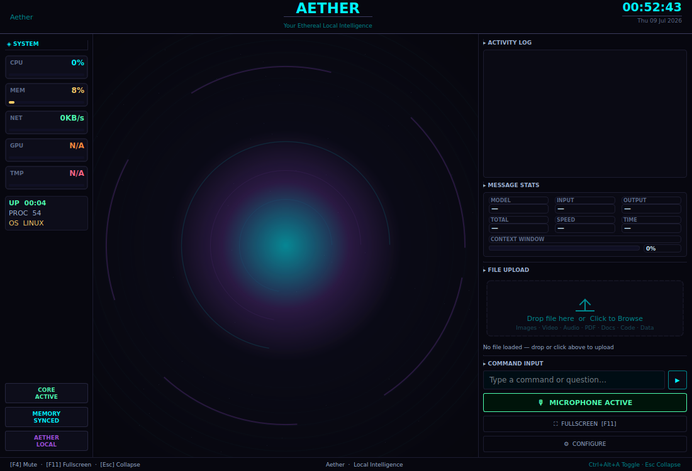

# 🌌 Aether — Your Ethereal Local Intelligence

> A fully local, privacy-first voice AI assistant with a premium ethereal sci-fi HUD.
> Cross-platform, runs entirely on local hardware. No cloud APIs required.

---

## Screenshots

<p align="center">
  <br>
  <em>The main HUD — Aether Core orb, system panel, activity log, and controls</em>
</p>

<p align="center">
  
  
  
</p>
<p align="center"><em>The Aether Core orb — listening, thinking, and speaking states</em></p>

> These are placeholder renders generated headlessly (no live model/system data). Swap them out for real screenshots taken on your machine once you've got Aether running — that'll show off actual CPU/GPU readings, a live conversation, and your chosen face image if you use one.

---

## Overview

Aether is a fully local, real-time voice and visual AI agent. It combines offline speech recognition, a locally hosted LLM (via Ollama), and text-to-speech to deliver a privacy-first personal assistant with OS-level control capabilities.

Successor to the previous mark, which used the Google Gemini Live API. Aether removes all cloud LLM dependencies while adding streaming responses, a dynamic configuration UI, and multi-language support.

---

## Architecture

```
Microphone → STT (Whisper / Vosk)
                  ↓
           Ollama LLM (tool calling + streaming)
                  ↓
         Tool Execution (OS, Browser, Files …)
                  ↓
           TTS (EdgeTTS / Kokoro / ElevenLabs)
                  ↓
              Speaker
```

### Core Components

| Layer | Technology | Notes |
|-------|-----------|-------|
| **STT** | faster-whisper / Vosk | Fully offline. Auto language detection or forced locale. |
| **LLM** | Ollama (any model) | qwen2.5, llama3.2, mistral, etc. Streaming + tool calling. |
| **TTS** | EdgeTTS / Kokoro / ElevenLabs | EdgeTTS = free + internet. Kokoro = fully offline. |
| **UI** | PyQt6 | Ethereal cyan/purple HUD — glowing "Aether Core" orb, conversation log, system monitor. |
| **Agent** | Custom task queue | Multi-step planner + executor + error recovery. |

---

## Features

- **Streaming responses** — TTS starts speaking on the first sentence, not after the full response
- **Tool calling** — 20 built-in tools: browser control, file management, weather, YouTube, messaging, screen analysis, code helper, game updater, flight finder, and more
- **Long-term memory** — Silently saves personal facts; recalled in every conversation
- **Hybrid memory** — BM25 keyword + dense semantic + cross-encoder reranker for accurate recall across sessions
- **Goal manager** — Persistent goals survive restarts; the LLM always knows your active goals and sub-tasks
- **RAG engine** — Index your Obsidian vault, PDFs, Markdown files; query from them by voice
- **Plugin system** — Drop any `.py` file into `plugins/` and Aether loads it instantly (hot-reload, no restart needed)
- **Live configuration** — Change LLM model, STT engine, TTS voice without restarting (⚙ Configure button)
- **Ollama auto-start** — Automatically launches `ollama serve` if it's not running
- **Multi-language STT** — Set `stt_language` to `auto` (Whisper detects) or a specific locale (`tr`, `de`, `fr`, …)
- **Cross-platform** — Windows, macOS, Linux (OS detected automatically at runtime)
- **File drop zone** — Drag and drop images, PDFs, Word docs, CSV, audio, video for AI processing
- **OSINT toolkit** — WHOIS, DNS, subdomain enumeration, breach checks, port scan, Google dorks, IP geolocation
- **MCP bridge** — Connect external MCP servers (Obsidian, GitHub, Postgres, …) via config
- **Self-evaluator** — Scores every response; logs failures with reason and score to `logs/events.jsonl`
- **Observability** — Structured event log, in-memory metrics, lightweight tracing around every tool call
- **Loop guard** — Detects when the LLM is stuck calling the same tool and breaks the cycle automatically
- **Crash logger** — Structured JSON crash reports in `logs/crashes/` for every unhandled exception
- **Self-test mode** — `/selftest` runs an end-to-end check of every subsystem and prints a pass/fail report
- **Memory tools** — `/backup`, `/memstats`, `/prune` to manage, snapshot, and clean the memory DB
- **Config validation** — Startup check catches bad keys, unreachable Ollama, unknown engines before a crash
- **v3 integrations** — Optional LangChain (web search, Wikipedia, ReAct research), LlamaIndex (production RAG), Open Interpreter (natural language shell)
- **Web dashboard / phone remote** *(new, ported from Mark-XLVIII)* — Local FastAPI dashboard (default `http://<this-pc-ip>:8000`) with QR-code phone pairing, AES-256 encrypted text commands, live log streaming over WebSocket, and file upload/download. Requires `fastapi`, `uvicorn`, `cryptography`, `python-multipart`. **Note:** upstream's phone-mic → cloud realtime-audio pipeline (built for Gemini Live) was not ported, since Aether's voice stack is local Whisper STT rather than a cloud realtime session — the endpoint accepts audio frames but nothing currently consumes them. Text commands and file transfer are fully wired.
- **Proactive check-ins** *(new, ported from Mark-XLVIII)* — After a configurable idle period (`proactive_min_silence_secs`, default 15 min), Aether hands your memory context to the LLM and lets it decide whether there's something worth saying unprompted, with a cooldown (`proactive_check_cooldown`, default 10 min) between check-ins.
- **System resource monitor** *(new, ported from Mark-XLVIII)* — Background CPU/RAM/temperature/GPU polling with cross-platform, subprocess-free readings (ctypes/NVML/psutil); triggers a spoken warning when a threshold is crossed, with a 5-minute cooldown per metric.

---

## Web Dashboard

Starts automatically on boot if its dependencies are installed:

```bash
pip install fastapi "uvicorn[standard]" cryptography python-multipart
```

Open `http://<this-pc-ip>:8000` in a browser on the same network, or use the QR-code pairing flow from the desktop UI to connect a phone. Commands sent from the dashboard are AES-256-CBC encrypted client-side and land in the same text-command pipeline as typed input in the desktop app.

---

## Chat Commands

| Command | Action |
|---------|--------|
| `/selftest` | Run full system self-test |
| `/crashes` | Show recent crash logs |
| `/backup` | Snapshot memory to a zip file |
| `/memstats` | Show memory system statistics |
| `/prune` | Remove duplicate / old memories from DB |
| `/status` or `"status"` | Full system diagnostic (Ollama, GPU, packages, …) |
| `/clear` | Clear chat history and session memory |
| `obs report` | Show observability metrics and tool call counts |

---

## Requirements

- Python 3.11 or 3.12
- [Ollama](https://ollama.com) installed and a model pulled (e.g. `ollama pull qwen2.5:7b`)
- A microphone

---

## Installation (Recommended)

For the cleanest setup with no dependency conflicts, use the provided installer scripts that create an isolated virtual environment:

### Windows Users
1. Double-click `install.bat` to create a virtual environment and install dependencies
2. Double-click `run.bat` to activate the environment and launch Aether

### Linux/macOS Users
1. Make the scripts executable: `chmod +x install.sh run.sh`
2. Run the installer: `./install.sh`
3. Launch the application: `./run.sh`

The installer scripts will:
- Check for Python 3.11+
- Create a virtual environment in `venv/`
- Install required packages from `requirements.txt`
- Provide activation scripts for easy launching

---

## Quick Start

```bash
# 1. Install Ollama → https://ollama.com
#    Then pull a model:
ollama pull qwen2.5:7b

# 2. Clone / download the project and launch
cd Aether
python main.py
```

That's it. On first run Aether:
1. Auto-installs base packages (PyQt6, numpy …) and restarts once
2. Opens the **Initialisation** overlay — choose STT engine, LLM model, TTS engine
3. Click **INITIALISE SYSTEMS** — engine packages install in the background (progress shown in log)
4. Aether comes online

After setup, use the **⚙ CONFIGURE** button in the right panel to change any setting at any time without restarting.

---

## Configuration (`config/api_keys.json`)

```json
{
    "stt_engine":         "whisper",
    "stt_model":          "base",
    "stt_language":       "auto",
    "llm_url":            "http://localhost:11434",
    "llm_model":          "qwen2.5:7b",
    "tts_engine":         "edgetts",
    "tts_voice":          "en-US-GuyNeural",
    "elevenlabs_api_key": ""
}
```

| Key | Values | Default |
|-----|--------|---------|
| `stt_engine` | `whisper` / `vosk` | `whisper` |
| `stt_model` | `tiny` / `base` / `small` / `medium` / `large-v3` | `base` |
| `stt_language` | `auto` or ISO code (`tr`, `en`, `de` …) | `auto` |
| `llm_url` | Ollama API base URL | `http://localhost:11434` |
| `llm_model` | Any model pulled in Ollama | `qwen2.5:7b` |
| `tts_engine` | `edgetts` / `kokoro` / `elevenlabs` | `edgetts` |
| `tts_voice` | Voice name / ID depending on engine | `en-US-GuyNeural` |

---

## Built-in Tools

| Tool | Description |
|------|-------------|
| `open_app` | Opens any application or website |
| `web_search` | Web search and compare mode |
| `weather_report` | Current weather for any city |
| `send_message` | WhatsApp / Telegram messaging |
| `reminder` | Timed reminders via Task Scheduler |
| `youtube_video` | Play, summarize, trending videos |
| `screen_process` | Screen capture + vision model analysis |
| `computer_settings` | Volume, brightness, window management, shortcuts |
| `browser_control` | Full Playwright browser automation |
| `file_controller` | File/folder CRUD, search, disk usage |
| `desktop_control` | Wallpaper, organize, clean desktop |
| `code_helper` | Write, edit, explain, run code |
| `dev_agent` | Build complete multi-file projects |
| `agent_task` | Multi-step autonomous task execution |
| `computer_control` | Direct mouse/keyboard control |
| `game_updater` | Steam / Epic Games install & update |
| `flight_finder` | Google Flights search |
| `file_processor` | Process images, PDFs, CSV, audio, video |

---

## Keyboard Shortcuts

| Key | Action |
|-----|--------|
| `F4` | Mute / unmute microphone |
| `F11` | Toggle fullscreen |
| `Ctrl+Alt+A` | Show / hide window from anywhere |
| `Esc` | Collapse the HUD down to just the orb (press again to restore) |

---

## TTS Engine Comparison

| Engine | Internet | Quality | Cost |
|--------|----------|---------|------|
| EdgeTTS | Required | Good | Free |
| Kokoro | No | Excellent | Free (local model ~100 MB) |
| ElevenLabs | Required | Best | Paid API |

---

## Notes on v3 Integrations

`open-interpreter` depends on `litellm` which can conflict with `langchain` and `llama-index`.
If you hit dependency errors, install them in separate virtual environments or pin known-good versions.

Also: if Ollama is running but you haven't pulled your configured model yet, run:

```bash
ollama pull qwen3:8b   # or whatever llm_model is set to in your config
```

Aether will suggest this automatically if the model is missing, but it's faster to do it before first launch.

---

## Customising the System Prompt

Aether's core personality and rules live in `core/prompt.txt`. You can edit this file to change how Aether responds — its tone, response length limits, tool routing priorities, and memory trigger rules — without touching any Python code.

The file is hot-loaded each time a message is processed, so changes take effect immediately (no restart needed).

Key sections in `prompt.txt`:
- **IDENTITY** — name, personality, tone
- **TOOL CALLING RULES** — when to call tools vs. reply in text
- **BRIEFING** — hard response length limits (default: 3 sentences max)
- **MEMORY RULE** — what personal facts to silently save
- **TOOL ROUTING** — which tool to use for which task type
- **INTEGRATION TOOLS** — LangChain / Open Interpreter / LlamaIndex routing guide

---

## License

MIT
